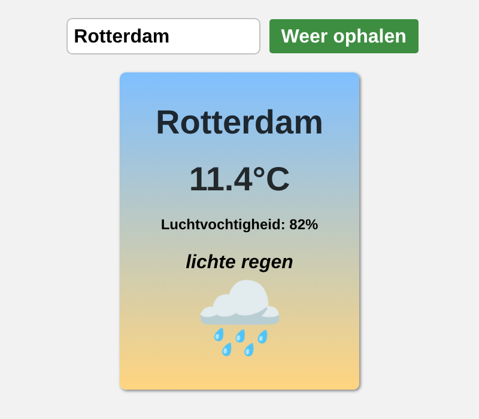

# WeatherLite

Een simpele weer-app in de browser. Je typt een stad in en ziet de temperatuur, de luchtvochtigheid, een korte beschrijving van het weer en een passend emoji.

Gemaakt in mijn eerste jaar Software Developer aan het Grafisch Lyceum Rotterdam.

## Hoe het werkt

- Bij het versturen van het formulier haalt JavaScript met `fetch` de weerdata op bij de [OpenWeatherMap API](https://openweathermap.org/current).
- De API geeft het antwoord terug als JSON, met de temperatuur in graden Celsius en de beschrijving in het Nederlands (`units=metric&lang=nl`).
- Met destructuring haal ik de stad, temperatuur, luchtvochtigheid, beschrijving en weer-ID uit de data.
- Het weer-ID bepaalt welk emoji je ziet (onweer, regen, sneeuw, mist, zon of bewolkt).
- Bestaat een stad niet of gaat er iets mis, dan zie je een duidelijke foutmelding.

## Gebruikte technieken

- HTML
- CSS (flexbox)
- JavaScript (`fetch`, `async`/`await`, `try`/`catch`, destructuring, `switch`)
- OpenWeatherMap API

## Wat ik heb geleerd

- Gegevens ophalen bij een externe API met `fetch` en `async`/`await`
- Fouten afvangen met `try`/`catch` en de statuscode van een antwoord controleren
- Waardes uit een JSON-object halen met destructuring
- Elementen aanmaken met `createElement` en tonen op de pagina
- Een API-sleutel buiten Git houden met een apart bestand en `.gitignore`

## Zelf uitproberen

1. Maak een gratis account aan op [openweathermap.org](https://home.openweathermap.org/users/sign_up) en kopieer je API-sleutel.
2. Kopieer `config.example.js` naar een nieuw bestand `config.js`.
3. Vervang in `config.js` de tekst `plak-hier-je-sleutel` door je eigen sleutel.
4. Open `index.html` in je browser en zoek een stad.

Een nieuwe sleutel kan tot een paar uur nodig hebben voordat hij werkt.
# weatherlite
